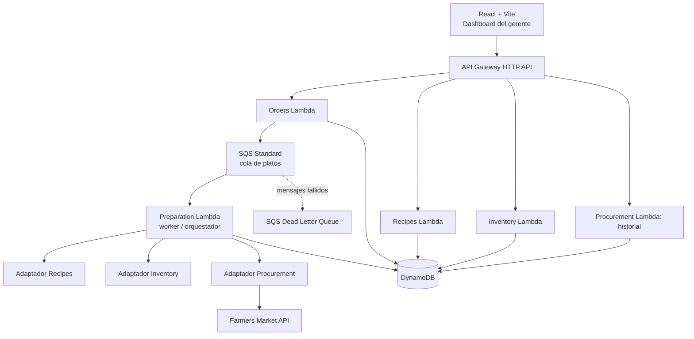

# PLANNING — Jornada de Almuerzo Gratis

**Reto técnico:** Alegra — Backend Developer (Node.js)  
**Periodo de ejecución:** viernes 16 a jueves 22 de octubre de 2026 (zona horaria: America/Bogota)  
**Tiempo presupuestado:** 27 horas de trabajo efectivo  
**Estado al crear este documento:** planificación aprobada; desarrollo sin iniciar  
**Repositorio:** privado; URL por completar  
**URL pública:** por completar  

> Este documento presenta el plan previo al desarrollo. Las estimaciones, decisiones, riesgos y criterios de aceptación se revisarán con evidencia durante la implementación. No implica que los componentes o pruebas ya estén terminados.

## 1. Objetivo y alcance

Crear una aplicación web accesible públicamente para que un gerente solicite **X platos** de una jornada de comida gratuita y visualice su procesamiento. La solución debe asignar recetas aleatorias de **seis recetas**, verificar ingredientes, comprar automáticamente los faltantes mediante la API de mercado provista y entregar cada plato únicamente cuando cuente con todos sus ingredientes. Se prioriza una solución backend robusta y fácil de operar.

### Requisitos obligatorios

- Backend en **Node.js + TypeScript**, sin Express, NestJS ni otros frameworks backend prohibidos.
- Arquitectura de **microservicios**, implementada mediante funciones AWS Lambda y límites funcionales definidos.
- Seis recetas precargadas; cada una usa al menos un ingrediente permitido: `tomato`, `lemon`, `potato`, `rice`, `ketchup`, `lettuce`, `onion`, `cheese`, `meat`, `chicken`.
- Existencia inicial de **cinco unidades de cada ingrediente** en un despliegue nuevo.
- Compras mediante `https://recruitment.alegra.com/api/farmers-market/buy` con el parámetro `ingredient`; respuesta `quantitySold` entera positiva indica venta, `0` indica no disponibilidad. No se presupone que la API entregue exactamente la cantidad solicitada.
- Descontar ingredientes al preparar, nunca entregar sin ingredientes suficientes; registrar los pedidos, sus estados, el inventario y las compras.
- Dashboard React: botón para pedir X platos; órdenes en preparación, inventario, historial de compras, historial de pedidos y recetas con ingredientes.
- Persistencia entre reinicios; soportar múltiples pedidos concurrentes sin corrupción de datos.
- Publicar URL funcional; repositorio privado de GitHub con `scouting@alegra.com` como colaborador.
- Documentar planificación antes de implementar, arquitectura y funcionamiento. Entregar por el formulario indicado en el correo inicial.

### Fuera de alcance (para proteger el plazo)

- CRUD administrativo de recetas, inventario y usuarios; las recetas y el inventario base se cargan mediante un *seed* controlado e idempotente.
- Autenticación de usuarios, pagos, imágenes de platos, sistema de mesas, analítica avanzada, WebSockets y Kubernetes.
- IA integrada como objetivo obligatorio: se mantiene como **P2** y solo se implementará si el flujo completo, las pruebas esenciales y el despliegue están terminados. De implementarse, debe funcionar en producción y documentarse.

## 2. Decisiones técnicas y justificación (ADR inicial)

| Decisión | Opción | Motivo / compromiso |
|---|---|---|
| Backend | Node.js + TypeScript; manejadores Lambda nativos | Cumple restricción sin frameworks prohibidos; seguridad de tipos. |
| Infraestructura | AWS SAM + CloudFormation | Despliegue reproducible como código. |
| Cómputo | AWS Lambda por servicio | Menor administración de servidores y experiencia Serverless. |
| API pública | Amazon API Gateway HTTP API | Enrutamiento y CORS centralizados. |
| Proceso asíncrono | Amazon SQS Standard → Lambda Preparation Worker | Desacoplar peticiones HTTP del trabajo de cocina y amortiguar picos. |
| Persistencia | Amazon DynamoDB, capacidad on-demand | Evitar gestión de servidores y conexiones SQL. |
| Integridad | `ConditionExpression` + `TransactWriteItems` | Consumo condicional y estados idempotentes, sin inventario negativo. |
| Frontend | React + Vite + TypeScript | Dashboard de una página, rápido de desarrollar. |
| Hospedaje frontend | S3 público mediante hosting estático **solo si** su configuración y costo son aceptables; alternativa: AWS Amplify Hosting si está disponible en el plan | Elegir y registrar URL definitiva durante el despliegue. S3 por sí solo no proporciona HTTPS en el endpoint de sitio web; para un frontend HTTPS usar Amplify o S3 + CloudFront según disponibilidad y presupuesto. |
| Pruebas | Vitest; mocks de mercado; pruebas integradas contra entorno de AWS | Desarrollo ágil y escenarios deterministas. |
| Observabilidad | CloudWatch Logs y métricas mínimas; logs con `orderId`/`itemId` | Depuración y operación reproducibles. |
| Bonus IA | Postergado (P2) | No comprometer alcance y estabilidad. |

**Límite de arquitectura:** cinco microservicios lógicos (Orders, Recipes, Inventory, Preparation, Procurement), cada uno con handler Lambda y código de dominio aislado en monorepo. Para el plazo se propone **una tabla DynamoDB compartida con claves y permisos separados por dominio** como compromiso de infraestructura; esto **no** representa aislamiento total de datos por microservicio. Si se exige aislamiento físico estricto, pasar a tablas separadas antes de codificar (mayor complejidad). El orquestador de preparación se comunica con adaptadores de dominio explícitos; no se deben hacer dependencias circulares ni escritura directa no autorizada entre módulos.

### Componentes y responsabilidades

1. **Orders Service:** valida `quantity`, crea pedido e ítems, ofrece consultas de estado/historial, encola trabajos. Una llamada puede crear varios ítems; para limitar duración y escrituras, definir `MAX_ORDER_ITEMS` y validar su valor.
2. **Recipes Service:** expone las seis recetas y sus ingredientes. Los datos son de solo lectura durante la ejecución; la selección aleatoria se registra por ítem para que los reintentos no cambien la receta.
3. **Inventory Service:** consulta existencias, registra reposiciones y efectúa consumo atómico asociado a un ítem, bajo condiciones de suficiencia; evita saldos negativos.
4. **Preparation Service:** recibe mensajes SQS por plato, selecciona/recupera receta, solicita abastecimiento cuando haga falta, cambia estados y finaliza la preparación. Define políticas de reintento, idempotencia y recuperación.
5. **Procurement Service:** encapsula integración con mercado, valida `quantitySold`, registra intentos y resultados, y repone existencias confirmadas. Maneja `0`, fallos de red, timeout y respuestas inválidas.

## 3. Diagrama de arquitectura



**Comunicación:** HTTP para operaciones públicas; evento `PrepareOrderItem` para procesamiento interno; comunicación a través de contratos de dominio explícitos en el worker. Los adaptadores pueden compartir código de librerías del monorepo para evitar invocaciones Lambda→Lambda innecesarias; los límites de responsabilidad deben reflejarse en permisos, módulos y pruebas. Documentar esta compensación (servicios lógicos frente a microservicios desplegados de forma independiente).

### Estructura propuesta del repositorio

```text
/
├── PLANNING.md
├── README.md
├── AGENTS.md
├── docs/
│   ├── ARCHITECTURE.md
│   ├── DECISIONS.md
│   └── TESTING.md
├── apps/
│   └── web/                  # React + Vite
├── services/
│   ├── orders/
│   ├── recipes/
│   ├── inventory/
│   ├── preparation/
│   └── procurement/
├── packages/
│   ├── shared/               # Tipos, validaciones y utilidades
│   └── persistence/          # Acceso a DynamoDB y operaciones atómicas
├── infra/
│   └── template.yaml         # AWS SAM
├── tests/
│   ├── integration/
│   └── load/
└── package.json
```

## 4. Contratos de datos y API (propuesta inicial)

### Entidades de dominio mínimas

| Entidad | Datos mínimos |
|---|---|
| Ingredient | `name`, `stock`, `updatedAt` |
| Recipe | `recipeId`, `name`, `ingredients[{name, quantity}]` |
| Order | `orderId`, `quantity`, `status`, `createdAt`, `updatedAt` |
| OrderItem | `itemId`, `orderId`, `recipeId`, `status`, `attempts`, `createdAt` |
| PurchaseAttempt | `purchaseId`, `itemId`, `ingredient`, `quantitySold`, `status`, `createdAt`, `error?` |
| StockMovement | `movementId`, `itemId?`, `ingredient`, `delta`, `reason`, `createdAt` |

**Índices y claves tentativas:** claves de acceso por tipo de registro (`PK`,`SK`), índices según consultas por estado y fecha; evitar scans para vistas de alta frecuencia. Fijar claves definitivas durante el diseño del sábado. Los registros deben vincularse a `orderId`/`itemId` para permitir auditoría e idempotencia.

### Endpoints públicos mínimos

| Verbo | Ruta | Respuesta / propósito |
|---|---|---|
| POST | `/orders` | `{ quantity }` → `202 Accepted`, `orderId` y estado inicial. |
| GET | `/orders` | Historial de pedidos (paginado o acotado). |
| GET | `/orders/{orderId}` | Pedido, ítems y sus estados. |
| GET | `/preparations` | Ítems en cola/preparación/espera, con estados. |
| GET | `/inventory` | Stock actual de los diez ingredientes. |
| GET | `/recipes` | Las seis recetas y sus ingredientes. |
| GET | `/purchases` | Historial de intentos/ventas confirmadas. |

Estados mínimos por ítem: `PENDING`, `PREPARING`, `WAITING_INGREDIENTS`, `DELIVERED`, `FAILED`. Las transiciones deben estar validadas y ser monotónicas cuando corresponda. El estado agregado del pedido se deriva de los estados de sus ítems; un pedido parcialmente servido no debe aparecer como completamente entregado.

## 5. Consistencia, concurrencia y compras

### Invariantes (no negociables)

1. Nunca entregar un plato si no se han consumido todas las unidades de su receta.
2. Nunca dejar unidades negativas; usar condición `stock >= required` en actualización atómica por ingrediente.
3. Cada ítem se consume **a lo sumo una vez**, mediante marcador `itemId` y escritura transaccional conjunta con el estado de entrega y movimientos de stock.
4. Un mensaje SQS duplicado no genera una segunda entrega ni un segundo descuento.
5. Los eventos de compra confirmados solo incrementan inventario una vez (idempotencia por `purchaseId`).
6. No perder pedidos por reinicios; si falla el envío a SQS luego de persistir el pedido, contemplar recuperación controlada (reconciliación de pendientes o patrón outbox) y documentar el mecanismo implementado.

### Algoritmo previsto por ítem

1. Leer registro de ítem; si ya está `DELIVERED`, terminar sin efectos secundarios.
2. Recuperar la receta asignada; si no existe, seleccionar aleatoriamente entre seis y persistirla **solo si aún no existe**.
3. Consultar ingredientes requeridos; intentar una **transacción DynamoDB** para consumir todos los ingredientes necesarios y cambiar ítem a `DELIVERED` en una misma operación, con precondiciones de stock y de estado. Crear movimientos/auditoría dentro de los límites transaccionales cuando sea viable.
4. Si falta stock, determinar faltantes y solicitar compras de los ingredientes necesarios sin mantener transacciones abiertas. Dado que `quantitySold` no garantiza satisfacer el faltante, actualizar inventario solo con cantidades enteras positivas confirmadas.
5. Reintentar el consumo transaccional. Si mercado devuelve `0` o error recuperable, marcar `WAITING_INGREDIENTS`, reprogramar con backoff controlado y límite de reintentos; nunca bloquear una invocación Lambda esperando durante minutos.
6. Si el caso no puede resolverse automáticamente dentro de la política, registrar `FAILED` y la causa para trazabilidad; no afirmar que la entrega fue exitosa.

**Advertencia de integración externa:** el enunciado no declara una clave de idempotencia para el endpoint del mercado. Una petición que caduca tras llegar al mercado puede haber ejecutado una compra sin respuesta confiable. No se puede garantizar *exactly-once* en esa frontera externa; registrar intentos, usar timeouts y reintentos limitados, y documentar explícitamente el riesgo residual de compras repetidas. No inventar una cantidad vendida.

**SQS:** recepción *at-least-once*; configurar timeout de Lambda y visibility timeout compatibles, `batchSize=1` inicialmente para simplificar recuperación, DLQ con `maxReceiveCount` definido, y límites de concurrencia pequeños al comenzar. Para lotes mayores, evaluar `ReportBatchItemFailures`.

**Alta demanda:** el endpoint de creación no debe esperar la preparación de platos. Acotar `quantity` por solicitud y pruebas escalonadas (10, 50 y 100 ítems); la escalabilidad se evalúa por integridad, throughput y latencia observable, no por afirmaciones no probadas.

## 6. Cronograma detallado y dependencias

**Capacidad estimada según disponibilidad:** viernes 2 h; sábado 5,5 h; domingo 10 h de trabajo efectivo (con descansos); lunes 3,5 h; martes 2 h; miércoles 2 h; jueves 2 h. **Total 27 h.** Revisar cada noche el tiempo real; el domingo de 10 horas es el supuesto más exigente.

### Viernes 16 — Arquitectura y primera Lambda (2 h)

| ID | Tarea | Tiempo | Depende de | Entregable verificable |
|---|---|---:|---|---|
| INF-01 | Definir arquitectura, entidades, flujo y estados | 0,5 h | — | Diagrama y decisiones documentadas |
| DOC-01 | Crear repositorio privado, `PLANNING.md`, estructura inicial | 0,5 h | INF-01 | Primer commit |
| INF-02 | Configurar AWS CLI, SAM, roles mínimos, créditos y presupuesto | 0,5 h | Cuenta AWS | Acceso validado, presupuesto/alerta creada |
| INF-03 | Desplegar Lambda «health» mediante SAM | 0,5 h | INF-02 | Endpoint de prueba invocable |

**Hito D1:** `PLANNING.md` versionado y primera función accesible. **Corte:** si la cuenta no permite desplegar, resolver acceso antes de avanzar con servicios.

### Sábado 17 — Persistencia y servicios base (5,5 h)

| ID | Tarea | Tiempo | Depende de | Entregable verificable |
|---|---|---:|---|---|
| CORE-01 | Workspace TypeScript, scripts, tipos compartidos y validación | 0,75 h | INF-01 | Build y lint básicos |
| DB-01 | Tabla DynamoDB, claves/índices y seeds idempotentes | 1,0 h | INF-02, CORE-01 | Diez ingredientes con stock 5; seis recetas |
| INV-01 | Servicio de consulta y operaciones atómicas de inventario | 1,25 h | DB-01 | Consultas y condición de stock |
| REC-01 | Servicio de recetas y selección aleatoria persistible | 0,75 h | DB-01 | `GET /recipes`, seis recetas |
| ORD-01 | `POST /orders`, ítems, consultas y validaciones | 1,0 h | DB-01 | Pedido de X platos registrado |
| QA-01 | Tests básicos y commit de hito | 0,75 h | INV-01, REC-01, ORD-01 | Tests ejecutables localmente |

**Hito D2:** pedidos, recetas e inventario consultables; aún no se considera terminado el flujo. **Corte:** el domingo empieza con persistencia funcional.

### Domingo 18 — Integración completa (10 h)

| ID | Tarea | Tiempo | Depende de | Entregable verificable |
|---|---|---:|---|---|
| PRE-01 | SQS, DLQ y worker de preparación | 1,25 h | ORD-01, INF-03 | Pedido produce trabajo asíncrono |
| PRE-02 | Asignar/persistir receta por ítem | 0,75 h | PRE-01, REC-01 | Reintento mantiene receta |
| INV-02 | Consumo transaccional de ingredientes y estado | 1,5 h | INV-01, PRE-02 | No hay stock negativo ni doble consumo |
| BUY-01 | Adaptador mercado, validaciones e historial | 1,25 h | DB-01 | Compra real integrada, estados registrados |
| BUY-02 | `quantitySold=0`, timeouts y reintentos acotados | 1,0 h | BUY-01 | Estado recuperable sin falsa entrega |
| PRE-03 | Integrar compra → stock → consumo → entrega | 1,25 h | INV-02, BUY-02 | Flujo extremo a extremo funcionando |
| QA-02 | Casos de concurrencia e idempotencia | 1,0 h | PRE-03 | Pruebas de ítems duplicados y stock |
| WEB-01 | React: pantalla inicial, formulario y consultas | 1,0 h | ORD-01, REC-01 | Interfaz funcional básica |
| DEP-01 | Despliegue integrado de una versión inicial | 1,0 h | PRE-03, WEB-01 | URL de prueba con flujo completo |

**Hito D3 (CRÍTICO):** solicitar diez platos desde la aplicación, abastecer faltantes y observar estados hasta entrega o espera/fallo correctamente explicados. No iniciar bonus IA antes de este hito.

### Lunes 19 — Endurecimiento y conexión UI (3,5 h)

| ID | Tarea | Tiempo | Depende de | Entregable verificable |
|---|---|---:|---|---|
| WEB-02 | Integrar dashboard con pedidos, recetas e inventario | 1,0 h | WEB-01, DEP-01 | Vistas consumen API real |
| WEB-03 | Historias de compras y estados de preparación | 0,75 h | BUY-01, PRE-03 | Historiales visibles |
| PRE-04 | Asegurar recuperación, DLQ y prevención duplicados | 0,75 h | QA-02 | Fallos y reintentos controlados |
| QA-03 | Simular pedidos concurrentes 10–50 y corregir | 1,0 h | PRE-04 | Evidencia en logs/tests |

**Hito D4:** dashboard de operaciones conectado y flujo robusto en las pruebas realizadas.

### Martes 20 — UX mínima y publicación pública (2 h)

| ID | Tarea | Tiempo | Depende de | Entregable verificable |
|---|---|---:|---|---|
| WEB-04 | Polling 3–5 s, errores y estado de carga | 1,0 h | WEB-03 | La UI refleja evolución de pedidos |
| DEP-02 | Frontend HTTPS, CORS, accesibilidad pública y smoke test | 1,0 h | WEB-04 | URL final accesible fuera de cuenta AWS |

**Hito D5:** la app puede probarse públicamente desde un navegador limpio.

### Miércoles 21 — Pruebas y documentación (2 h)

| ID | Tarea | Tiempo | Depende de | Entregable verificable |
|---|---|---:|---|---|
| QA-04 | Regresión, fallos externos y reinicios | 0,75 h | DEP-02 | Resultado registrado en `docs/TESTING.md` |
| DOC-02 | README, contratos API, arquitectura y decisiones | 0,75 h | QA-04 | Repositorio comprensible/reproducible |
| QA-05 | Prueba con usuario no técnico | 0,5 h | DEP-02 | Ajustes críticos de usabilidad |

**Hito D6:** documentación y verificación final de requisitos obligatorios.

### Jueves 22 — Entrega y contingencia (2 h)

| ID | Tarea | Tiempo | Depende de | Entregable verificable |
|---|---|---:|---|---|
| QA-06 | Smoke tests en URL pública | 0,5 h | DEP-02 | Solicitud y consulta correctas |
| OPS-01 | Revisar costos, logs, permisos, secretos y recursos | 0,5 h | INF-02 | Control de riesgo de costos y seguridad |
| DOC-03 | Verificar URLs y colaborador `scouting@alegra.com` | 0,333 h | DOC-02 | Permisos y links correctos |
| SUB-01 | Enviar formulario oficial y guardar confirmación | 0,333 h | QA-06, DOC-03 | Evidencia de envío |
| BUF-01 | Reserva para incidentes de última hora | 0,334 h | — | Margen de contingencia |

**Hito D7:** entrega confirmada mediante el formulario del correo inicial, idealmente antes del cierre del día. Horario exacto del formulario: **pendiente de confirmar**.

### Regla diaria de control

Al cerrar cada jornada: registrar tiempo planeado/real, tareas completas, pruebas ejecutadas, principales riesgos y bloqueo siguiente. Si un hito crítico se atrasa más de una hora, recortar primero pulido visual, luego tests secundarios, y finalmente mejoras P1 no críticas; **nunca** recortar integridad del inventario, persistencia, flujo automatizado o URL pública.

## 7. Backlog priorizado y criterios de terminación

**P0 — imprescindible**

- [ ] Infraestructura AWS SAM y despliegue de APIs.
- [ ] Seis recetas válidas y diez ingredientes con cinco unidades al inicio.
- [ ] Pedido de `X` platos con validación, estado persistente y consulta.
- [ ] Cola asíncrona y procesamiento de pedidos sin intervención humana.
- [ ] Consulta y consumo seguro de ingredientes.
- [ ] Mercado integrado; compras e historial persistentes; `quantitySold=0` manejado.
- [ ] No entregar sin consumo válido; impedir descuento duplicado.
- [ ] Frontend React con todas las vistas solicitadas.
- [ ] URL pública y documentación de instalación/despliegue.
- [ ] Repositorio privado y colaborador requerido.

**P1 — robustez y mantenibilidad**

- [ ] Reintentos controlados, recuperación de pendientes y DLQ.
- [ ] Pruebas de concurrencia, idempotencia y errores externos.
- [ ] Paginación/acotación de consultas, logs y controles de costos.
- [ ] Mejoras de usabilidad y diseño responsivo.

**P2 — opcional**

- [ ] IA que explique riesgos de desabastecimiento usando datos reales; documentar modelo, coste, límites y resultados; integrar solo si todos los P0/P1 críticos están completos.

**Definition of Done de cada tarea:** código integrado en rama principal, build correcto, validación probada, error manejado, logs mínimos y cambio documentado cuando afecte contratos o arquitectura. No marcar un requisito como completado solo por generar código mediante IA.

## 8. Plan de pruebas y aceptación

| Caso | Acción | Criterio de aceptación | Prioridad |
|---|---|---|---|
| T01 | Crear 1 plato | Pedido e ítem persistidos; procesamiento empieza sin bloquear HTTP | P0 |
| T02 | Crear 10 platos | Exactamente diez ítems; asignaciones de las seis recetas permitidas | P0 |
| T03 | Consultar stock nuevo | Diez ingredientes con 5 unidades cada uno | P0 |
| T04 | Consumir plato con stock | Descuento exacto de ingredientes y estado `DELIVERED` | P0 |
| T05 | Faltan ingredientes | Solicita compra al mercado y usa solo `quantitySold` confirmado | P0 |
| T06 | Mercado devuelve 0 | Ítem no entregado; `WAITING_INGREDIENTS` y política de reintento | P0 |
| T07 | Dos ítems compiten por stock | Ningún ingrediente negativo; resultado consistente | P0 |
| T08 | Reprocesar mismo mensaje | No hay doble descuento ni entrega | P0 |
| T09 | Reiniciar/redeploy worker | Persisten estados, compras e inventario | P0 |
| T10 | API devuelve error / timeout | No se inventan ventas; fallo observable y reintento limitado | P1 |
| T11 | Crear 50–100 ítems | Se encolan y procesan sin perder/duplicar ítems; medir duración y errores | P1 |
| T12 | Abrir URL sin sesión AWS | Se pueden solicitar pedidos y ver todas las listas | P0 |
| T13 | Dos POST concurrentes | Se registran ambos pedidos; solicitud repetida bajo clave idempotente no duplica | P1 |
| T14 | Verificar costos y permisos | Presupuesto activo; ninguna credencial en repositorio o frontend | P0 |

**Evidencia:** guardar comandos, capturas pertinentes, resultados, tiempos de pruebas de carga y limitaciones conocidas en `docs/TESTING.md`. No atribuir throughput sin medición real.

## 9. Matriz de riesgos

| Riesgo | Prob. | Impacto | Respuesta / gatillo |
|---|---|---|---|
| Inexperiencia con AWS Serverless | Alta | Alto | Despliegue mínimo el viernes; resolver IAM/SAM antes del sábado. |
| AWS plan gratuito limita algún servicio | Media | Alto | Validar disponibilidad en cuenta y región antes de crear recursos; ajustar hosting sin abandonar AWS innecesariamente. |
| Créditos consumidos/cargos | Media | Alto | Revisar créditos/plan; presupuesto con alerta; limitar concurrencia, logs y volumen de pruebas; evitar NAT Gateway y recursos caros. |
| Domingo con 10 h demasiado exigente | Alta | Alto | Pausas, tickets pequeños y congelar alcance. Si capacidad real es menor, adelantar tareas el sábado o reducir P1. |
| Stock concurrente se vuelve negativo | Media | Muy alto | Transacciones/condiciones DynamoDB y tests de concurrencia antes del frontend. |
| SQS duplica o reintenta eventos | Alta | Alto | Idempotencia persistida por `itemId`; DLQ; batch pequeño. |
| POST persiste pedido pero no se encola | Media | Alto | Recuperación de `PENDING` mediante reconciliación/outbox documentada; pruebas de fallo entre pasos. |
| Timeout de compra con resultado incierto | Media | Alto | Historial de intentos, reintentos acotados y documentación del límite de exactly-once externo. |
| API de mercado no disponible | Media | Alto | Pruebas unitarias con mock; estados de espera; no falsificar éxito en producción. |
| Frontend HTTP/HTTPS o CORS falla | Media | Alto | Probar publicación HTTPS y CORS desde el martes como máximo, idealmente el domingo. |
| Retraso de documentación o formulario | Media | Alto | PLANNING temprano, README incremental, entrega jueves con reserva. |

## 10. Costos, seguridad y operación AWS

- Confirmar **plan de cuenta y créditos vigentes en consola**; la elegibilidad y disponibilidad de servicios depende de la cuenta. Los créditos no garantizan costo cero en todos los escenarios.
- Configurar AWS Budgets / alertas y revisar consumo diariamente. Las alertas no sustituyen un límite rígido universal de gasto.
- Usar una región única, políticas IAM de mínimo privilegio por Lambda y nombres de recursos con prefijo del reto.
- No incluir secretos, AWS keys ni tokens en Git. Usar variables de entorno/configuración apropiada; la URL del mercado no requiere credenciales inventadas.
- Limitar concurrencia del worker y `MAX_ORDER_ITEMS`; logs estructurados evitando almacenar datos sensibles innecesarios.
- DynamoDB on-demand con operaciones condicionales; registrar el consumo aproximado durante pruebas de carga.
- Documentar ruta de despliegue (`sam build`, `sam deploy`) y limpieza eventual de recursos **después** de la evaluación; no destruir la aplicación antes de que pueda revisarse.

## 11. Colaboración con asistentes de IA durante el desarrollo

Herramientas: VS Code, Claude y Codex. Usarlas para acelerar implementación, tests, documentación y revisión, pero validar manualmente cada cambio.

- Ticket pequeño por módulo con entradas, salidas, errores y aceptación verificable.
- No pedir cambios simultáneos sobre los mismos archivos.
- Revisar diffs antes de commit, ejecutar tests, revisar dependencias y recursos de AWS.
- Mantener `docs/DECISIONS.md` actualizado con motivos de cambios y trade-offs.
- No presentar como implementado, probado o medido algo que solo ha sido propuesto por un agente.

## 12. Entregables y checklist de envío

- [ ] URL pública de la aplicación React con flujo funcional.
- [ ] URL del repositorio privado en GitHub.
- [ ] `scouting@alegra.com` invitado como colaborador (verificar invitación/acceso).
- [ ] `PLANNING.md` y `README.md` completos.
- [ ] `docs/ARCHITECTURE.md`, `docs/DECISIONS.md`, `docs/TESTING.md` según avance.
- [ ] Pruebas mínimas P0 ejecutadas y limitaciones explícitas.
- [ ] Confirmar fecha/hora exacta límite en correo de convocatoria.
- [ ] Enviar **exclusivamente por el formulario del correo inicial** y conservar confirmación.

## 13. Referencias técnicas

- Enunciado adjunto: *Reto técnico — Jornada de Almuerzo Gratis* (Alegra, cuatro páginas).
- AWS Lambda + SQS: https://docs.aws.amazon.com/lambda/latest/dg/with-sqs.html
- Respuestas parciales SQS: https://docs.aws.amazon.com/lambda/latest/dg/services-sqs-errorhandling.html
- AWS Free Tier y créditos: https://docs.aws.amazon.com/awsaccountbilling/latest/aboutv2/free-tier.html

---

**Criterio final de éxito:** un evaluador ajeno al proyecto puede abrir una URL pública, solicitar múltiples platos y observar su preparación, la compra automática cuando faltan ingredientes, el inventario y los historiales; el sistema mantiene integridad de datos con solicitudes concurrentes y fallas recuperables, y el repositorio explica su diseño y sus limitaciones.
